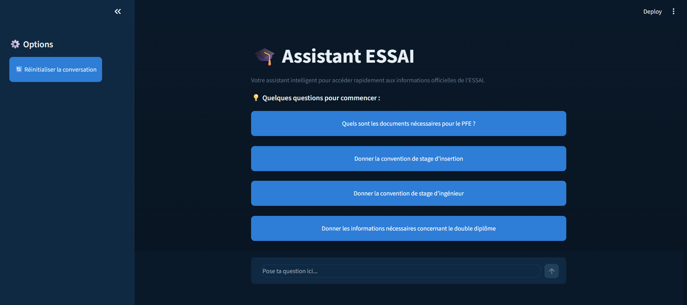

# ESSAI Assistant

An **AI-powered chatbot** that gives ESSAI students **instant, accurate answers** to their administrative and academic questions .

## Why It Matters

The school's administration was **overloaded with repetitive email questions** (enrollment, courses, exams, deadlines). This assistant answers them **automatically, 24/7**, using the school's own official documents as its source of truth — **reducing administrative workload** while giving students **faster, more reliable answers** than searching through scattered PDFs themselves.

## What I Built

I **designed and implemented the full pipeline end-to-end**: document ingestion, a **hybrid retrieval system** (combining semantic search and keyword search for higher accuracy), a **reranking layer** to surface the most relevant answer, and a **local LLM-based generation step** — all wrapped in a usable chat interface.

**Key engineering decisions** I made to make it production-reliable rather than a demo:

- **Combined two retrieval methods** instead of one, to compensate for the weaknesses of each on a small, real-world document set.
- **Built in a safeguard** so the system says "I don't know" instead of making up an answer when nothing relevant is found.
- **Added a confidence check** so a bad reranking result never overrides a good initial result.
- **Handled real student language** (abbreviations, informal phrasing) instead of assuming clean, formal queries.

## Impact

- **Cuts repetitive administrative email volume** by giving students self-service answers.
- Runs **fully on local, open-source models** — no per-query API cost, no student data sent to third parties.
- **Designed to scale** to new document sets with minimal rework.

## Author

**Sarra Lamouchi** — Data Science & AI Engineering student, ESSAI
